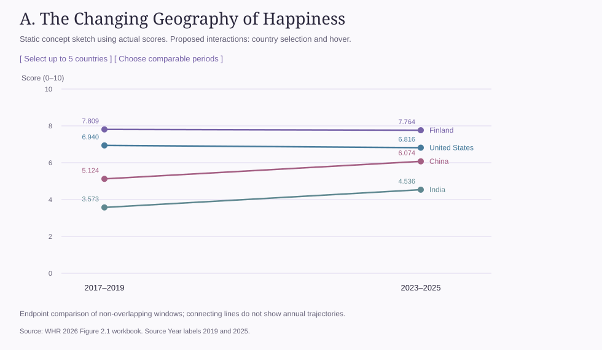
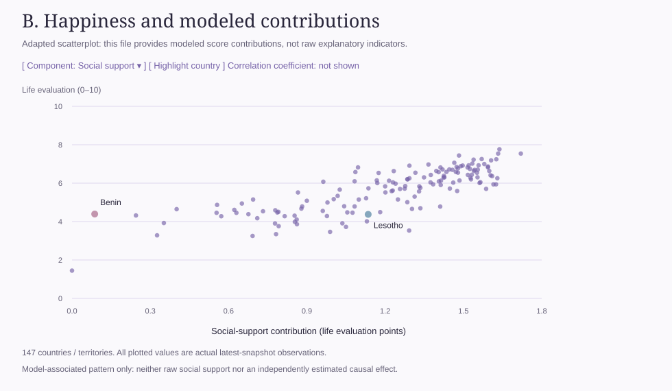
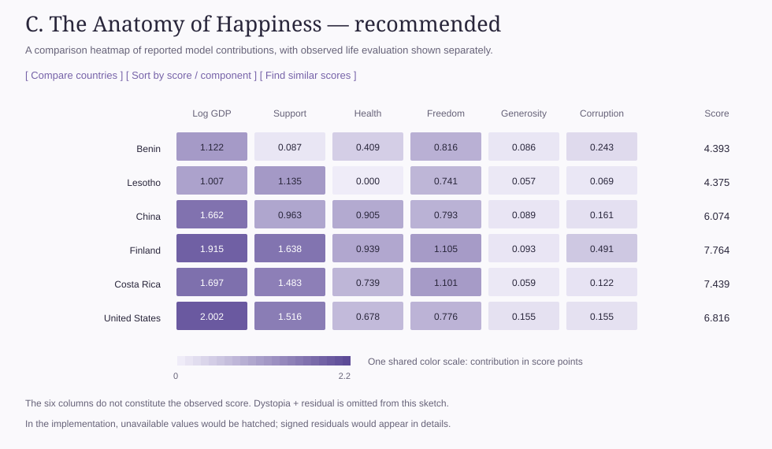

# The Anatomy of Happiness
## Exploring Global Happiness and the Factors Associated with Life Satisfaction

A Data Exploration assignment built on the official World Happiness Report 2026 Figure 2.1 workbook, with three interactive D3 v7 views on one page.

Open [the interactive project](index.html). To preview locally, run `python3 -m http.server 8765` from the folder that contains `js_data exploration`, then visit `http://127.0.0.1:8765/js_data%20exploration/`. D3 and all data are bundled locally.

Contents: [Step 2 — Dataset](#step-2--document-the-dataset) · [Step 3 — Exploration](#step-3--explore-the-data) · [Step 4 — Questions](#step-4--ask-questions) · [Step 5 — Proposals A, B, C](#step-5--three-proposed-uses) · [Step 6 — Chart](#step-6--the-interactive-chart)

> **Important — what the six “explanatory factors” are.** The workbook contains six columns named *Explained by: Log GDP per capita, Social support, Healthy life expectancy, Freedom to make life choices, Generosity,* and *Perceptions of corruption*. These are **modeled contributions**: the report’s estimate of how much of each country’s score its regression model attributes to each factor, measured in life-evaluation points. They are **not raw indicators** (not dollars, years of life, or survey percentages), and they are **not proven causes of happiness**. The happiness score itself comes from survey respondents’ own life evaluations; it is not calculated from these six columns. See the [official FAQ](https://www.worldhappiness.report/faq/).

---

## Step 2 — Document the Dataset

| Item | Details |
|---|---|
| **Dataset name** | World Happiness Report 2026 — Data for Figure 2.1 (`WHR26_Data_Figure_2.1.xlsx`) |
| **Source / organization** | *World Happiness Report*, published by the Wellbeing Research Centre at the University of Oxford in partnership with Gallup, the UN Sustainable Development Solutions Network, and an independent editorial board. Life evaluations come from the Gallup World Poll. |
| **URL** | Data page: <https://www.worldhappiness.report/data-sharing/> · File: <https://files.worldhappiness.report/WHR26_Data_Figure_2.1.xlsx> |
| **Date accessed** | October 13, 2026 |
| **Brief description** | Country-level national averages of life evaluation (the Cantril ladder, 0–10) from each annual report’s ranking. Every row is one country or territory in one ranking snapshot. It contains the score, its rank, a 95% confidence interval, and, for recent snapshots, the report’s breakdown of the score into six modeled contributions plus *Dystopia + residual*. |
| **Time period covered** | 14 ranking snapshots labelled `Year` 2011, 2012 and 2014–2025 (no 2013 snapshot). Each label is the **end year of a pooled survey window**. Most windows are three years long (e.g. `2025` = surveys from 2023–2025). The `2011` snapshot covers 2005–2011. Overall survey coverage: **2005–2025**. |
| **Geographic coverage** | Worldwide, country / territory level. 168 distinct country or territory names across all snapshots; 147 in the latest (2023–2025) snapshot. No region, continent or coordinate fields. |
| **Number of rows** | 2,116 data rows (excluding the header) |
| **Number of columns** | 13 |
| **File format** | Microsoft Excel (`.xlsx`), one worksheet. A values-only CSV export (`data/whr_figure_2_1.csv`) is used for reproducibility. |
| **Data license / terms of use** | The data-sharing page states that the Figure 2.1 data are “available to download for free.” No named license (such as CC BY or CC0) or further terms are given on that page or in the workbook, so the data are used here with citation to the World Happiness Report. The underlying Gallup World Poll microdata are proprietary and **not** included. D3’s ISC license applies only to the bundled library, not to this data. |

The original workbook is kept unchanged in `data/` (SHA-256 `576e3826…8028`).

---

## Step 3 — Explore the Data

All statistics below were recomputed directly from the workbook. Each one states the snapshot it describes. Country averages are **unweighted**: each country counts once, regardless of population.

### Variables

| Column | Type | Notes |
|---|---|---|
| `Year` | Time (ordinal snapshot label) | End year of the survey window, not the publication year (the 2026 report = `Year 2025`). 14 unique values. |
| `Rank` | Numerical, ordinal | 1 = highest score in that snapshot. Rank gaps do not represent equal score gaps. |
| `Country name` | Categorical, **geographic** | 168 unique names overall, 147 in 2025. The only geographic field. |
| `Life evaluation (3-year average)` | Numerical, continuous (0–10) | **The key outcome variable.** Mean answer to the Cantril ladder question. |
| `Lower whisker`, `Upper whisker` | Numerical | 95% confidence interval for the score. |
| Six `Explained by: …` columns | Numerical (modeled contributions, in score points) | Model output, not raw data (see the note at the top). |
| `Dystopia + residual` | Numerical (score points, can be negative) | Benchmark of a hypothetical lowest-scoring country plus everything the model leaves unexplained. |

- **Important variables:** `Life evaluation`, `Year`, `Country name`, and the six contributions.
- **Numerical:** `Rank`, `Life evaluation`, both whiskers, the six contributions, and `Dystopia + residual` (11 columns).
- **Categorical:** `Country name` (`Year` can also be treated as an ordered category).
- **Date / time:** `Year` (snapshot label for a multi-year window).
- **Geographic:** `Country name` only.
- **Particularly interesting:** the 14-snapshot score history (for change over time), and the six contributions. Countries with nearly equal scores can have very different contribution profiles.

### Descriptive statistics — life evaluation score

**Latest snapshot, `Year 2025` (surveys 2023–2025), n = 147:**

| Statistic | Value |
|---|---:|
| Minimum | 1.446 (Afghanistan) |
| Maximum | 7.764 (Finland) |
| Mean | 5.650 |
| Median | 5.937 |
| Range | 6.318 |
| 25th / 75th percentile | 4.666 / 6.576 |
| Unique score values | 145 of 147 |

The mean is below the median because a small group of very low scores pulls it down.

**Comparison across snapshots:**

| Snapshot (survey window) | n | Min | Max | Mean | Median | Range |
|---|---:|---:|---:|---:|---:|---:|
| `2012` (2010–2012) | 156 | 2.936 | 7.693 | 5.419 | 5.326 | 4.757 |
| `2019` (2017–2019) | 153 | 2.567 | 7.809 | 5.473 | 5.515 | 5.242 |
| `2025` (2023–2025) | 147 | 1.446 | 7.764 | 5.650 | 5.937 | 6.318 |
| All 14 snapshots pooled | 2,116 | 1.364 (Afghanistan, `2024`) | 7.856 (Denmark, `2011`) | 5.466 | 5.480 | 6.492 |

Different snapshots contain different sets of countries, so these rows are not a like-for-like trend.

### Counts and percentages

**`Year 2025` scores by one-point band (n = 147):**

| Band | 1–2 | 2–3 | 3–4 | 4–5 | 5–6 | 6–7 | 7–8 |
|---|---:|---:|---:|---:|---:|---:|---:|
| Countries | 1 | 0 | 12 | 33 | 30 | 61 | 10 |
| Share | 0.7% | 0.0% | 8.2% | 22.4% | 20.4% | 41.5% | 6.8% |

No country scores below 1 or at 8 or above. 71 countries (48.3%) score 6 or higher.

**Countries per snapshot:** 2011: 156 · 2012: 156 · 2014: 158 · 2015: 157 · 2016: 155 · 2017: 156 · 2018: 156 · 2019: 153 · 2020: 149 · 2021: 146 · 2022: 137 · 2023: 143 · 2024: 147 · 2025: 147.

**Coverage over time:** 129 of 168 country names (76.8%) appear in all 14 snapshots.

**Change between `2019` (2017–2019) and `2025` (2023–2025), same 144 countries:**
- 90 rose (62.5%) and 54 fell (37.5%).
- The average change was +0.099 points.
- Largest rise: Viet Nam (+1.075). Largest fall: Afghanistan (−1.121).
- Full list: [matched_changes.csv](matched_changes.csv).

### Descriptive statistics — six modeled contributions (`Year 2025`, score points)

| Modeled contribution | n | Min | Max | Mean | Median | Range | Unique values |
|---|---:|---:|---:|---:|---:|---:|---:|
| Log GDP per capita | 147 | 0.000 | 2.167 | 1.535 | 1.565 | 2.167 | 138 |
| Social support | 147 | 0.000 | 1.720 | 1.205 | 1.292 | 1.720 | 141 |
| Healthy life expectancy | 146 | 0.000 | 1.238 | 0.616 | 0.607 | 1.238 | 134 |
| Freedom to make life choices | 146 | 0.000 | 1.147 | 0.882 | 0.913 | 1.147 | 133 |
| Generosity | 147 | 0.000 | 0.295 | 0.106 | 0.106 | 0.295 | 102 |
| Perceptions of corruption | 147 | 0.000 | 0.512 | 0.148 | 0.115 | 0.512 | 117 |
| Dystopia + residual | 145 | −0.295 | 2.701 | 1.163 | 1.164 | 2.996 | 137 |

A larger average contribution does **not** mean that factor matters more to happiness. Contribution size depends on the model’s coefficients and benchmark, as well as on each country’s values.

### Missing and unusual values

| Column | Missing, all 2,116 rows | Missing, `2025` (147 rows) |
|---|---:|---:|
| `Year`, `Rank`, `Country name`, `Life evaluation` | 0 (0%) | 0 |
| `Lower whisker`, `Upper whisker` | 1,094 (51.7%) | 0 |
| Log GDP per capita · Social support · Generosity | 1,097 (51.8%) each | 0 |
| Perceptions of corruption | 1,098 (51.9%) | 0 |
| Freedom to make life choices | 1,099 (51.9%) | 1 (Tajikistan) |
| Healthy life expectancy | 1,100 (52.0%) | 1 (State of Palestine) |
| Dystopia + residual | 1,103 (52.1%) | 2 (Tajikistan, State of Palestine) |

- **Missing values follow a pattern.** Confidence intervals and contributions exist only from `Year 2019` onward. Every row from `2011` to `2018` has a score but no interval or contributions. In `2023`, 3 of 143 rows also lack contributions.
- Blanks are kept as missing and never replaced with 0. In `2025`, each of the six contributions has exactly one value of 0.000; these are recorded values, not blanks.
- **Negative residuals in `2025`:** Hong Kong SAR of China, Sri Lanka and Botswana (3 of 145). These are valid model results, not errors.
- **Outlier:** Afghanistan’s `2025` score (1.446) is the only value outside the 1.5 × IQR fences (1.801–9.441). It is flagged, not removed.
- **Name changes:** *Swaziland* in older snapshots is *Eswatini* in newer ones. This is the only name matched across snapshots, based on the [UN record](https://www.un.org/en/about-us/member-states/eswatini).
- There are no duplicate country–year rows.

### Potential problems and limitations

1. **The contributions are modeled, not measured.** Raw GDP, health or survey indicators are not in this file. The data cannot show which raw factor is most strongly correlated with happiness, and it cannot show causation.
2. **Overlapping survey windows.** Consecutive snapshots usually share two survey years, so each point is not an independent annual measurement. The 2011 window (2005–2011) is longer, and there is no 2013 snapshot. Countries are not necessarily surveyed in every year of a window.
3. **Changing country sets** (137–158 countries per snapshot). Changes over time should compare the same countries.
4. **Model definitions can change between report editions.** Historical contributions are therefore not compared over time.
5. **Small differences in rank are often not meaningful.** In `2025`, Iceland and Denmark differ by 0.001 points, and their confidence intervals overlap heavily.
6. **No regional field, and no population weighting.** Means describe the average country, not the average person in the world.

---

## Step 4 — Ask Questions

**1. How have happiness scores changed across countries over time?**
The data supports this question: it has 14 snapshots of `Life evaluation` per country (2005–2025), and 129 countries appear in every snapshot. For example, among the 144 countries in both `2019` and `2025`, 62.5% rose and the average change was +0.099 points. Answers should compare the same countries and treat each point as a multi-year average. → *Proposal A*

**2. How do the six modeled explanatory contributions relate to happiness scores across countries?**
The data supports this question: the 2025 snapshot has 146–147 complete country pairs of score and contribution for each factor. The question is about the report’s *model decomposition*. It does not ask whether raw GDP or social support causes happiness. Patterns and exceptions can be described; causal or “strongest driver” claims cannot. → *Proposal B*

**3. Can countries with similar happiness scores have different explanatory contribution profiles?**
Yes, the data shows this directly. In `2025`, Benin (4.393) and Lesotho (4.375) differ by only 0.018 points, but their social-support contributions are 0.087 and 1.135. This shows that the model splits their scores very differently. It does not show that their actual levels of social support differ by that amount. → *Proposal C*

---

## Step 5 — Three Proposed Uses

All three proposals were sketched first using real workbook values, then implemented as interactive views.

### A — Happiness over time



- **What it shows / does:** a line chart of life evaluation for up to eight selected countries across all 14 snapshots. Users choose start and end snapshots, highlight countries that rose or fell, and read exact values in tooltips and a data table. Lines break where a snapshot or country record is missing.
- **Who it is for:** students, journalists and general readers comparing national trajectories.
- **Why it matters:** news coverage focuses on rank. Showing actual score changes, together with the gaps in the record, gives a more honest picture of change.

### B — Happiness & explanatory factors



- **What it shows / does:** a `2025` (2023–2025) scatterplot of life evaluation (y) against one selectable modeled contribution (x, in score points). Users can filter by country name, highlight a country, and see exact values and confidence intervals. No regression line or correlation coefficient is drawn.
- **Who it is for:** students and readers who want to understand how the report explains national scores.
- **Why it matters:** it makes the report’s model visible while labelling it clearly as a model. This guards against the common misreading that these columns are raw measurements or causes.

### C — Happiness contribution profiles



- **What it shows / does:** a heatmap of the six `2025` contributions for up to eight countries. All columns share one 0–2.2-point color scale, every cell shows its value, and missing cells are hatched as N/A. Rows can be sorted by score, name or any contribution. A one-click Benin–Lesotho comparison is included.
- **Who it is for:** readers curious about why countries with similar scores might differ.
- **Why it matters:** one score hides very different modeled compositions, and this view makes that visible. The six cells do not add up to the score without *Dystopia + residual*, which is shown in the details.

---

## Step 6 — The Interactive Chart

[index.html](index.html) implements A, B and C with D3 v7. Each view has a title and subtitle, labelled axes with units, a data-source citation, tooltips with exact values, and an accessible data table. Each view also states which snapshot or survey window it uses.

<details>
<summary>Snapshot labels and their nominal survey windows</summary>

| `Year` | Survey window | Source |
|---|---|---|
| 2011 | 2005–2011 | [WHR 2015](https://files.worldhappiness.report/WHR15.pdf) |
| 2012 | 2010–2012 | [WHR 2013](https://files.worldhappiness.report/WHR13.pdf) |
| 2014 | 2012–2014 | [WHR 2015](https://files.worldhappiness.report/WHR15.pdf) |
| 2015 | 2013–2015 (some older surveys) | [WHR 2016](https://files.worldhappiness.report/WHR16_Vol01.pdf) |
| 2016–2025 | (Year − 2) to Year | Respective WHR 2017–2026 editions, e.g. [WHR 2026 ch. 2](https://www.worldhappiness.report/ed/2026/international-evidence-on-happiness-and-social-media/) |

</details>

### Reproducibility

```sh
python3 analyze.py        # 2025 records → data/happiness.js, data/summary.json
python3 build_history.py  # all 2,116 scores → data/history.js
python3 eda_review.py     # statistics → review_statistics.json, matched_changes.csv (needs pandas, openpyxl)
python3 verify_data.py    # checks every exported value against the original workbook (needs openpyxl)
```

No values are imputed, smoothed, normalized or adjusted. Displayed numbers are rounded to three decimals. Browser test results are in [VALIDATION.md](VALIDATION.md).

### Attribution and AI use

D3 v7.9.0 ([d3js.org](https://d3js.org/), ISC license in `vendor/LICENSE-d3`). Code, analysis scripts, sketches and prose were generated or revised with AI assistance (OpenAI Codex and Claude Code), as permitted by the [course policy](https://jjjiia.github.io/data_visualization_2026/policies.html). Prompts and decisions are recorded in [AI_ASSISTANCE.md](AI_ASSISTANCE.md), with the expanded implementation prompt in [IMPLEMENTATION_REQUEST.md](IMPLEMENTATION_REQUEST.md).

Data: World Happiness Report 2026, *Data for Figure 2.1*, accessed October 13, 2026.
