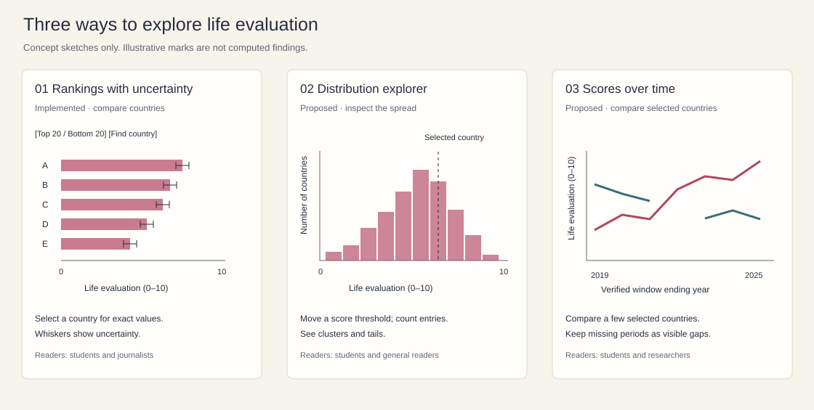

# A closer look at happiness

Data exploration and an interactive D3 chart using the **World Happiness Report 2026** public Figure 2.1 workbook.

**[Open the live chart](https://jieyishang7.github.io/js_data-visualization/js_data%20exploration/?v=whr2026-2)**

The chart compares average life evaluations for **147 countries and territories**, with the reported 95% confidence intervals. The 2026 report uses the **2023–2025** survey window; those observations are labeled **Year = 2025** in the workbook. These are not annual 2025 scores.

## Step 1 — Find a dataset

The selected topic is how people evaluate their lives around the world. This dataset supports exploration of rankings, distributions, uncertainty, historical comparisons, and model-based explanations. It is especially useful for asking whether a rank difference corresponds to a meaningful score difference.

The official free file is suitable for this assignment because it is publicly downloadable, structured as an Excel table, and contains 2,116 country–year-label observations. Restricted Gallup microdata are not needed for this project.

## Step 2 — Document the dataset

| Item | Description |
|---|---|
| Dataset name | World Happiness Report 2026 — Data for Figure 2.1 |
| Organization | University of Oxford, Wellbeing Research Centre, publishing with Gallup, the UN Sustainable Development Solutions Network, and an independent editorial board |
| Underlying survey source | Gallup World Poll for life evaluations |
| Website | https://www.worldhappiness.report/ |
| Data page | https://www.worldhappiness.report/data-sharing/ |
| Direct download | https://files.worldhappiness.report/WHR26_Data_Figure_2.1.xlsx |
| Accessed | October 13, 2026 |
| Description | Country/territory life evaluation averages, ranks, confidence intervals where available, six modeled contributions, and Dystopia + residual |
| Unit of observation | One country/territory in one source `Year` label; not one person |
| Time coverage | Source `Year` labels span 2011–2025, with 14 distinct labels and no 2013 entries. Verify individual historical aggregation windows before time comparisons. Latest rows cover 2023–2025. |
| Geographic coverage | Worldwide; 168 distinct country/territory labels across the full file, 147 in the latest snapshot. Labels are preserved as supplied. |
| Rows | 2,116 data rows, excluding the header; 147 in the chart’s latest snapshot |
| Columns | 13 original columns |
| Worksheet | `Data for Figure 2.1 (2011–2025)` — the workbook’s only sheet |
| Format | Original `.xlsx`; a values-only `.csv` export and a derived JavaScript chart snapshot are included |
| License / terms | The official data-sharing page makes Figure 2.1 data available to download for free. No named open-data license such as CC0 or CC BY was identified on that page or in the workbook. This project attributes the source and does not claim to relicense the data. Additional Gallup data have separate request/subscription arrangements. |

The original workbook is included unchanged in `data/`. The CSV preserves all 13 source headers and all 2,116 rows; blanks remain blank. SHA-256 of the original workbook: `576e382655cec3ae704a0b41cd2c04465b87cd84b7f131a0c4fa26d41f6d8028`.

## Step 3 — Explore the data

### Variables and meaning

| Variable(s) | Type | Interpretation |
|---|---|---|
| `Country name` | Categorical / geographic identifier | Country or territory label. There are no coordinates, continent fields, or population weights in this file. |
| `Year` | Temporal integer label | Identifies a source snapshot. For the latest snapshot, 2025 denotes the end of the 2023–2025 ranking period, published in WHR 2026. |
| `Rank` | Numerical, ordinal | Published position in that snapshot; rank differences are not equal score differences. |
| `Life evaluation (3-year average)` | Numerical | Average Cantril Ladder life evaluation on a 0–10 scale. |
| `Lower whisker`, `Upper whisker` | Numerical | Reported lower and upper endpoints of a 95% confidence interval for average life evaluation, when supplied. |
| Six `Explained by:` fields | Numerical, modeled contributions | Log GDP per capita, social support, healthy life expectancy, freedom to make life choices, generosity, and perceptions of corruption. Values are contributions in life evaluation points, not dollars, years of life, or raw survey percentages. |
| `Dystopia + residual` | Numerical, modeled remainder | The benchmark plus prediction residual. Can be negative; it is not another directly measured social indicator. |

The main variables of interest are **score, rank, and confidence interval width**. They help compare countries without treating a rank as a perfectly precise measurement. The contribution fields are interesting for follow-up questions, provided their model-derived nature is explicit.

### Missing data

| Original column | Missing in 2,116 rows | Missing in latest 147 |
|---|---:|---:|
| `Year` | 0 | 0 |
| `Rank` | 0 | 0 |
| `Country name` | 0 | 0 |
| `Life evaluation (3-year average)` | 0 | 0 |
| `Lower whisker` | 1,094 | 0 |
| `Upper whisker` | 1,094 | 0 |
| `Explained by: Log GDP per capita` | 1,097 | 0 |
| `Explained by: Social support` | 1,097 | 0 |
| `Explained by: Healthy life expectancy` | 1,100 | 1 |
| `Explained by: Freedom to make life choices` | 1,099 | 1 |
| `Explained by: Generosity` | 1,097 | 0 |
| `Explained by: Perceptions of corruption` | 1,098 | 0 |
| `Dystopia + residual` | 1,103 | 2 |

No country–Year key is duplicated. Every row has a score, country label, year, and rank. The 1,094 observations with year labels through 2018 have no confidence interval endpoints. Historical factor coverage also has gaps. Missing historical components must not be filled with zero.

In the latest snapshot, the missing component values occur in: **Healthy life expectancy: State of Palestine; Freedom to make life choices: Tajikistan; Dystopia + residual: Tajikistan, State of Palestine**. All of these observations remain in the chart because their scores and intervals are available. The detail panel shows unavailable components explicitly.

### Descriptive statistics — latest snapshot only

Statistics below use the source rows where `Year = 2025`. Each country/territory has equal weight; missing values are omitted separately for each variable. Numbers are rounded to three decimals for display. These are descriptive country-level summaries, **not a population-weighted estimate of global happiness**.

| Variable | Valid n | Minimum | Maximum | Mean | Median | Range |
|---|---:|---:|---:|---:|---:|---:|
| Life evaluation (3-year average) | 147 | 1.446 | 7.764 | 5.650 | 5.937 | 6.318 |
| Contribution: Log GDP per capita | 147 | 0.000 | 2.167 | 1.535 | 1.565 | 2.167 |
| Contribution: Social support | 147 | 0.000 | 1.720 | 1.205 | 1.292 | 1.720 |
| Contribution: Healthy life expectancy | 146 | 0.000 | 1.238 | 0.616 | 0.607 | 1.238 |
| Dystopia + residual | 145 | -0.295 | 2.701 | 1.163 | 1.164 | 2.996 |
| CI width (`Upper whisker − Lower whisker`) | 147 | 0.124 | 0.621 | 0.221 | 0.205 | 0.497 |

- **147 unique country/territory labels**, 147 source ranks, and **145 distinct rounded score values** occur in the latest snapshot.
- **71 / 147 (48.30%)** have scores of at least 6.000. **13 / 147 (8.84%)** have scores below 4.000.
- The highest score is **Finland: 7.764**, with interval **7.690–7.837**. The lowest is **Afghanistan: 1.446**, with interval **1.348–1.544**. Their score difference is **6.318 points**.
- The highest-ranked 20 scores span **0.943 points**, compared with **2.860 points** among the lowest-ranked 20. Equal-size ranking groups have quite different spreads.
- Iceland (**7.540**, CI **7.449–7.630**) and Denmark (**7.539**, CI **7.446–7.631**) illustrate how adjacent ranks can have almost identical rounded scores and strongly overlapping intervals. No formal pairwise significance test is performed here.

### Unusual values and limitations

1. **Negative model remainders:** Dystopia + residual is negative for Hong Kong SAR of China, Sri Lanka, and Botswana. These values are retained, not treated as data-entry errors. A prediction residual can be negative.
2. **Zero contributions:** A modeled contribution of zero is a valid number relative to the report’s benchmark. It does not mean a country has zero GDP, no lifespan, or no happiness.
3. **Historical coverage:** Year 2013 is absent from the workbook, and the number of entries varies from 137 to 158 per year label. Country labels can also change. Historical comparisons require aligned names and verified reporting periods.
4. **Overlapping periods:** Successive three-year windows share observations. They are not independent annual measurements, and they can smooth short-term events.
5. **Survey uncertainty:** Scores are estimates. Confidence intervals describe uncertainty around country averages, not the distribution of individual happiness. Overlap alone is not a formal test of equality.
6. **Model versus measurement:** The score comes from life evaluations. The six contribution fields explain variation using a model and do not establish causal effects. A plot of a contribution against the score would partly reflect how the model was constructed.
7. **Aggregation:** National averages hide differences within countries. This file lacks individual age, gender, income, survey sample sizes, and population weights needed for many deeper questions.
8. **Rounding:** Source values are rounded to three decimals. Some scores tie after rounding, and contribution sums may differ slightly from the score. Published ranks are preserved instead of recomputed from rounded scores.

## Step 4 — Ask questions

1. **Ranking and uncertainty:** Which countries have the highest and lowest average life evaluations, and how close are neighboring ranks once confidence intervals are shown? The implemented chart addresses this directly.
2. **Distribution:** Is the range of scores wider among the lowest-ranked 20 than among the highest-ranked 20? What proportion of countries have scores above a chosen threshold?
3. **Model relationship:** Among the latest observations with complete values, how is the modeled social-support contribution associated with life evaluation? Which countries depart from the overall association? Interpret this as model exploration, not causal evidence.
4. **Change over time:** For countries with consistent identifiers and comparable reporting windows, how did scores change between selected snapshots? Compare actual score differences, not only ranks, and acknowledge overlapping windows.
5. **Unusual observations:** Which countries have the largest positive or negative Dystopia + residual values, and which additional data would be needed to investigate them?

## Step 5 — Propose three uses and sketch them

The sketches are **conceptual wireframes**. Their marks show layouts, not additional computed findings.

| Proposal | What it shows / does | Audience | Why it matters |
|---|---|---|---|
| 1. Rankings with uncertainty — implemented | Horizontal bars on a fixed 0–10 scale, confidence-interval whiskers, top/bottom/all groups, country search, and a detail panel | Students, general readers, and journalists | Makes both the size of score differences and the uncertainty visible, rather than presenting ranks alone |
| 2. Distribution explorer — proposed | A histogram of country scores, with a selectable threshold and a selected country marker | Readers comparing one country with the broader sample | Shows concentration, spread, and tails; labels counts as countries rather than people |
| 3. Country comparison over time — proposed | Lines for a small set of selected countries across verified comparable three-year windows; visible gaps for unavailable periods | Students and researchers exploring change | Separates score changes from ranking changes while exposing missing coverage and overlap between periods |

## Step 6 — Make one interactive D3 chart

**Title:** A closer look at happiness.  
**Subtitle:** How do countries compare when people evaluate their own lives? Explore average life evaluations and the uncertainty behind the rankings.

- **Scope:** Latest 147 country/territory observations, `Year = 2025`, corresponding to WHR 2026’s 2023–2025 averages. The initial view shows the 20 highest-ranked entries.
- **Form:** Horizontal bars; the x-axis runs from 0 to 10 and remains fixed across filters. The y-axis identifies each country/territory and its published rank. Whiskers show the reported 95% confidence interval.
- **Interactivity:** Switch between the highest 20, lowest 20, and all 147. Search across the full latest snapshot. Toggle confidence intervals. Hover for exact values, or click/focus a row to inspect the country and model decomposition. Reset restores the initial view.
- **Access:** Native controls support keyboard navigation; chart rows can be focused and activated with Enter or Space. A collapsible HTML table shows every displayed row. Long charts scroll vertically; narrow screens can scroll the chart horizontally.
- **Missing data policy:** No latest scores or intervals are missing, so all 147 are eligible. Unavailable model components remain null and appear as “Not available.” No imputation is performed.
- **Attribution:** The chart links the official source, original workbook, downloadable full CSV, and this README.

### Open and reproduce

1. Open the [published chart](https://jieyishang7.github.io/js_data-visualization/js_data%20exploration/?v=whr2026-2).
2. For offline use, download the folder and open `index.html` in a browser. Keep its relative subfolders intact. Both D3 and the chart snapshot are local, so the chart does not require an internet connection. External reference links still require internet.
3. Run `python3 analyze.py` from this folder to reproduce `data/summary.json` and `data/happiness.js` from the included CSV. It uses only Python’s standard library.
4. To recreate the initial values-only CSV from the original Excel workbook, use pandas with an Excel reader: `pandas.read_excel("data/WHR26_Data_Figure_2.1.xlsx").to_csv("data/whr_figure_2_1.csv", index=False)`. The original workbook is never edited.

### Project files

| File | Purpose |
|---|---|
| `index.html`, `style.css`, `chart.js` | Interactive D3 chart and its presentation |
| `data/WHR26_Data_Figure_2.1.xlsx` | Unchanged official source workbook |
| `data/whr_figure_2_1.csv` | Full values-only export with original headers |
| `data/happiness.js` | Derived latest-snapshot data, embedded for offline opening |
| `data/summary.json` | Computed descriptive statistics and missing-value counts |
| `analyze.py` | Reproducible calculations and chart-snapshot generation |
| `sketches.svg` | Three proposed visualization designs |
| `vendor/d3.v7.min.js`, `vendor/LICENSE-d3` | D3 v7.9.0 and its ISC license; the library license does not apply to the WHR data |

### References

- Helliwell, J. F., Layard, R., Sachs, J. D., De Neve, J.-E., Aknin, L. B., & Wang, S. (Eds.). (2026). *World Happiness Report 2026*. University of Oxford: Wellbeing Research Centre. [Data sharing and download](https://www.worldhappiness.report/data-sharing/).
- World Happiness Report. [Frequently Asked Questions](https://www.worldhappiness.report/faq/). Definitions of life evaluation, confidence intervals, and modeled contributions.
- World Happiness Report 2026, Chapter 2. [International evidence on happiness and social media](https://www.worldhappiness.report/ed/2026/international-evidence-on-happiness-and-social-media/). Figure 2.1, ranking period, and interpretation.

### Validation

The data checks confirm 2,116 rows, 13 columns, no duplicated country–Year keys, 147 latest observations, scores within 0–10, and every latest score inside its reported interval. Browser checks confirmed 20 initial rows, 20 lowest-ranked rows ending in Afghanistan, 147 rows in the all-country view and HTML table, country search and empty-search handling, missing components for Tajikistan, the confidence-interval toggle, keyboard selection, and Reset. No browser console errors were observed. A narrow viewport was checked for page overflow; the chart scrolls inside its container. The page was tested via HTTP; direct `file://` navigation is not supported by the test browser.
